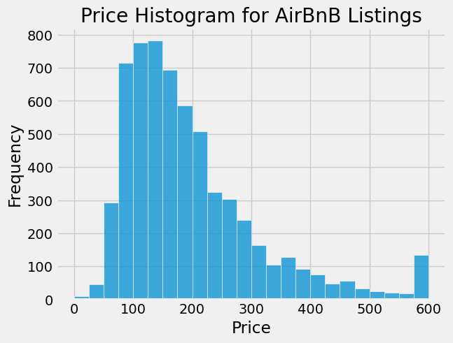
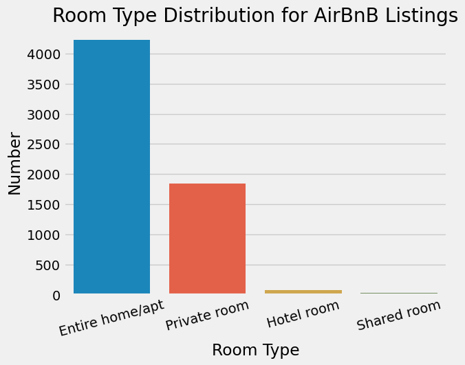
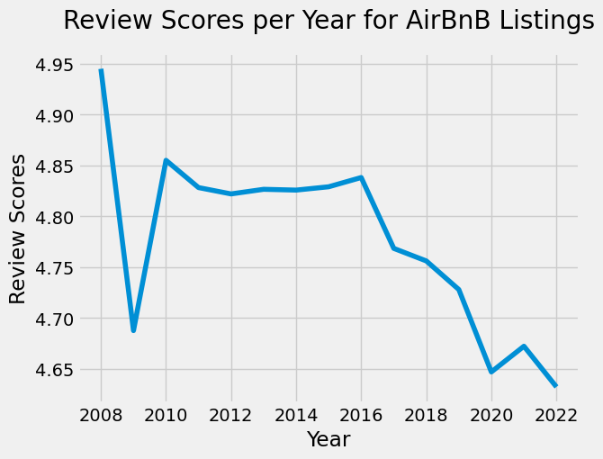
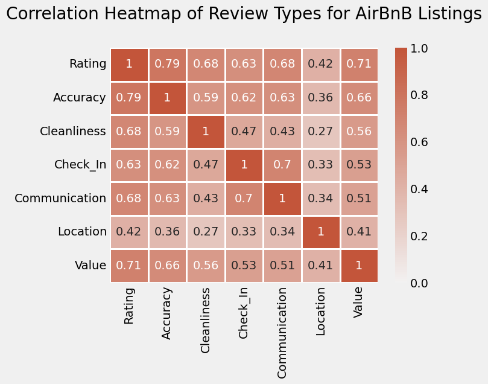
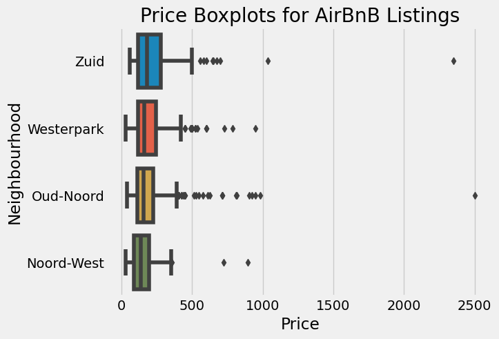

# Airbnb Amsterdam — Exploratory Analysis & Tableau Dashboards

Coursework project (Statistical Analysis & Visualisation, Visualization and Storytelling assignment) analysing Airbnb listings in Amsterdam with Python and Tableau.

## What's inside

| File | What |
|------|------|
| `airbnb_amsterdam_analysis.ipynb` | Python analysis (pandas, NumPy, Matplotlib, Seaborn) with observations after each plot |
| `airbnb_amsterdam_dashboards.twbx` | Tableau workbook with two interactive dashboards |
| `dashboard_summary.docx` | Written summary of what each dashboard shows |

## Charts from the notebook

| Price distribution | Listings per room type |
|---|---|
|  |  |

| Average rating by year | Correlation of rating sub-scores |
|---|---|
|  |  |



## Notebook: 7 tasks

1. Descriptive statistics: number of listings, average price, average rating
2. Histograms of `price`, `number_of_reviews`, `review_scores_rating`
3. Listings per `room_type`
4. Reviews vs ratings (scatter plot and jointplot)
5. Average rating over the years (line plot)
6. Correlation heatmap of the rating sub-scores
7. Price comparison across four neighbourhoods (box plot)

Some findings noted in the notebook:
- Most listings are priced between €50 and €300.
- Entire homes/apartments and private rooms make up most listings.
- Ratings are mostly 4.5 stars or above, but the yearly average rating trends downward.
- The overall rating correlates strongly with every sub-rating except location.

## Tableau dashboards

- **Overview:** pick a neighbourhood to see listing count, reviews, average rating/price/capacity/minimum nights, room-type mix and a map (dot size = price, colour = rating).
- **Growth and analysis:** listing growth by year, reviews per room type over time, top hosts and price distribution by room type, with neighbourhood and room-type filters.

## Running the notebook

The dataset (`airbnblistings.csv`, Amsterdam listings from the course) is packaged inside the Tableau workbook, because a `.twbx` is just a zip file. Extract it next to the notebook, then run:

```bash
# 1. get the CSV out of the workbook
python -c "import zipfile; z=zipfile.ZipFile('airbnb_amsterdam_dashboards.twbx'); [open('airbnblistings.csv','wb').write(z.read(n)) for n in z.namelist() if n.endswith('.csv')]"

# 2. install and run
pip install pandas numpy matplotlib seaborn jupyter
jupyter notebook airbnb_amsterdam_analysis.ipynb
```

Then run all cells (Cell -> Run All). The notebook already contains its saved outputs, so GitHub shows the charts without running anything.

To view the dashboards, open the `.twbx` in Tableau Public or Tableau Desktop.
